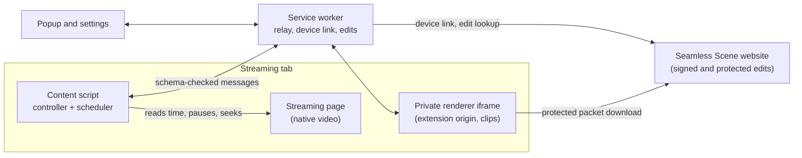

# Seamless Scene — Chrome extension

Seamless Scene plays fan edits on top of the video you are already streaming. An edit is a list of timings — "at 12:04, play this clip instead, then carry on from 12:19" — and the clips stay on your own device. The extension switches to the clip at the right moment and hands playback back to the stream afterwards. Nothing you watch is uploaded, and no video is downloaded from the streaming service.

This repository is the source of the extension published in the Chrome Web Store. It is **source-available, not open source**: you may read it, audit it and build it to check what the published extension does, but it is not licensed for reuse. See [LICENSE.md](LICENSE.md).

The store extension is the Viewer edition. A separate Creator edition, which adds tools for making and submitting edits, is distributed from the website to approved creators; its source is not in this repository.

- Website: https://seamlessscene.com
- Supported: Prime Video in desktop Chrome 133 or later (tested on Windows).
- Security reports: [SECURITY.md](SECURITY.md).

## What is in here

| Path | What it is |
| --- | --- |
| `packages/browser-extension` | The Manifest V3 extension: service worker, content script, popup, settings, the private playback renderer, and their tests. |
| `packages/protected-packet-core` | The protected edit-packet client (signature checks, licence handling, decryption) bundled into the extension. |
| `packages/fixtures` | Synthetic data used by the tests. No film footage. |
| `scripts` | The build, the protected-bundle generator, the edit rules generator and packet checks. |
| `docs` | [Architecture](docs/architecture.md), [building and testing](docs/building.md), [privacy](docs/privacy.md), [edit packets](docs/packet-format.md). |

## Build and test

```sh
npm ci
npm --prefix packages/protected-packet-core ci
npm test                 # extension and schema tests
npm run test:packet      # packet-core tests
npm run build            # the store build: build/extension/candidate-*/ (load it unpacked)
```

`npm run build` prints an `artifactSha256`, a hash over every file in the package. It is the same value as the package submitted to the Chrome Web Store for that version, so you can check the published extension against this code; [docs/building.md](docs/building.md) explains how.

## How it fits together



Clip bytes stay inside the renderer iframe; the page only sees opaque `asset:<sha256>` references. The full walkthrough is in [docs/architecture.md](docs/architecture.md).

## How it is developed

Seamless Scene is built by a small team working with AI coding assistants. Every change goes through the test suite (about 1,200 tests here), a reproducible build, and testing on real Prime Video playback before release.

## Contributing

Issues are welcome, especially compatibility and security reports. Because the code is not under an open-source licence, pull requests can only be accepted from contributors who agree that Open Creative Labs may use their contribution under the same terms. See [CONTRIBUTING.md](CONTRIBUTING.md).
